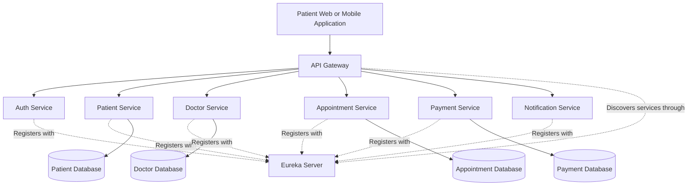
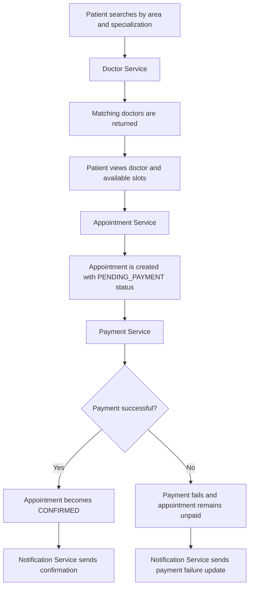
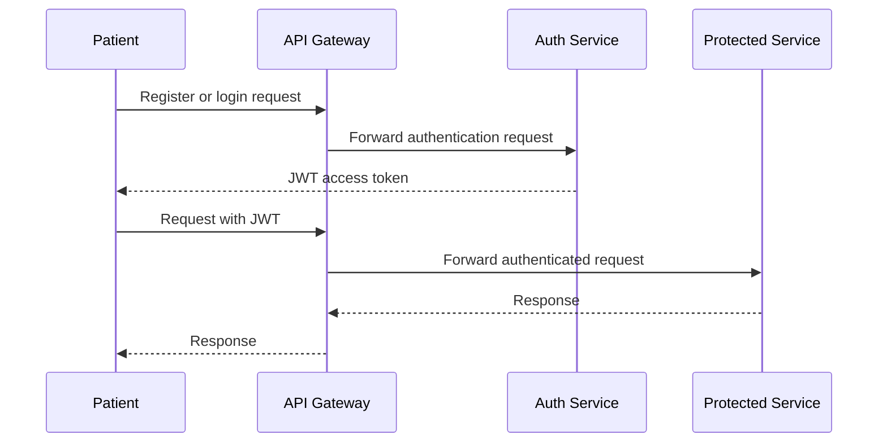

# Healthcare Appointment & Management Platform

A microservices-based healthcare platform where patients can search for doctors, view available appointment slots, book appointments, make payments, and receive notifications.

## Project Objective

This project is being developed as a complete backend system using Java and Spring Boot. It will demonstrate REST API development, microservices architecture, authentication, service-to-service communication, database management, testing, containerization, CI/CD, and AWS integration.

## Technology Stack

- Java 25
- Spring Boot
- Spring Data JPA
- Hibernate
- Spring Security
- JWT
- REST APIs
- Spring Cloud
- Eureka Service Discovery
- OpenFeign
- MySQL
- Docker
- Jenkins
- JUnit
- Mockito
- AWS S3
- AWS IAM

## Planned Microservices

| Service | Port | Responsibility |
|---|---:|---|
| API Gateway | 8080 | Main entry point, request routing, and common security checks |
| Auth Service | 8081 | Patient and doctor registration, login, JWT generation, and roles |
| Patient Service | 8082 | Patient profile, contact details, and medical profile information |
| Doctor Service | 8083 | Doctor profile, specialization, area, consultation fee, and doctor search |
| Appointment Service | 8084 | Appointment slots, booking, rescheduling, cancellation, and appointment status |
| Payment Service | 8085 | Payment creation, payment status, and mock payment processing |
| Notification Service | 8086 | Appointment and payment notifications |
| Eureka Server | 8761 | Service registration and service discovery |

Each business service will manage its own data. We will use separate MySQL databases or schemas so that one service does not directly access another service's database.

## High-Level Architecture



## Patient Appointment Flow



## Authentication Flow



## Service Communication

- The API Gateway routes external requests to internal services.
- Eureka maintains the service registry.
- OpenFeign will be used for synchronous communication between services.
- JWT will be used to authenticate requests.
- Each service will validate the JWT before accessing protected endpoints.
- Notification processing can begin with REST communication.
- Asynchronous messaging can be added later if the project requires it.

## Development Roadmap

### Phase 1: Repository and Project Foundation

- Create the GitHub repository.
- Create the `develop` branch.
- Add the project README.
- Create the base folder structure.
- Add common `.gitignore` rules.
- Commit and push the initial project documentation.

### Phase 2: Auth Service

- Create the Spring Boot Auth Service.
- Add patient and doctor user registration.
- Add MySQL persistence with Spring Data JPA.
- Add password hashing using BCrypt.
- Add login functionality.
- Generate and validate JWT tokens.
- Add role-based authorization.

### Phase 3: Patient Service

- Create patient profile APIs.
- Add patient contact information.
- Add profile update and retrieval APIs.
- Add validation and exception handling.
- Protect APIs using JWT.

### Phase 4: Doctor Service

- Create doctor profile APIs.
- Store doctor specialization and practice area.
- Add consultation fee and availability details.
- Implement doctor search by area and specialization.
- Add pagination and sorting.

### Phase 5: Appointment Service

- Create doctor availability and appointment slot APIs.
- Allow patients to book available slots.
- Prevent double booking.
- Add reschedule and cancellation functionality.
- Add appointment status tracking.

### Phase 6: Payment Service

- Create payment request and payment status APIs.
- Start with a mock payment implementation.
- Connect payment status with appointment status.
- Add successful, failed, and pending payment states.

### Phase 7: Notification Service

- Send appointment confirmation notifications.
- Send cancellation and rescheduling notifications.
- Send payment status notifications.
- Begin with a simple REST-based notification implementation.

### Phase 8: Spring Cloud Integration

- Add Eureka Service Discovery.
- Register all services with Eureka.
- Configure OpenFeign communication.
- Configure API Gateway routes.
- Add centralized request handling and security.

### Phase 9: Testing and Error Handling

- Add unit tests with JUnit and Mockito.
- Add controller and service-layer tests.
- Add validation and global exception handling.
- Test the complete patient appointment flow.
- Add API documentation.

### Phase 10: Docker, Jenkins, and AWS

- Create Dockerfiles for each service.
- Create Docker Compose configuration for local execution.
- Create Jenkins pipeline for build and test automation.
- Configure AWS IAM roles and permissions.
- Use AWS S3 for doctor profile images or medical documents.
- Keep secrets and AWS credentials outside the source code.

## Git Branch Strategy

- `main`: Stable and production-ready code.
- `develop`: Active integration branch.
- `feature/*`: Individual feature branches.

Example:

```text
main
└── develop
    ├── feature/auth-service
    ├── feature/patient-service
    ├── feature/doctor-service
    └── feature/appointment-service
```

## Important Security Rules

- Do not commit passwords, JWT secrets, AWS access keys, or database credentials.
- Store sensitive values in environment variables.
- Do not store card numbers or CVV values.
- Use tokenized payment data when connecting a real payment provider.
- Do not use real patient information during development.
- Validate and authorize every protected request.

## Current Status

- GitHub repository created.
- `main` branch connected to `origin/main`.
- `develop` branch is being used for active development.
- Project documentation and architecture are being prepared.
- Auth Service will be the first service implemented.